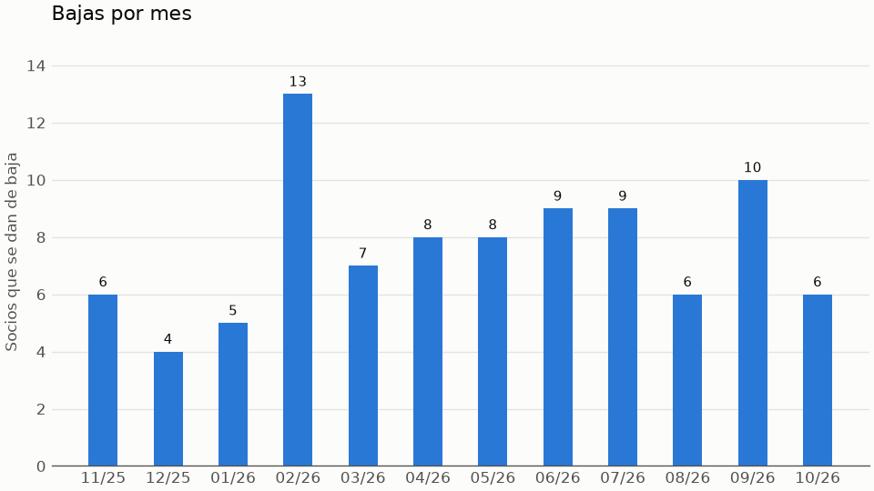
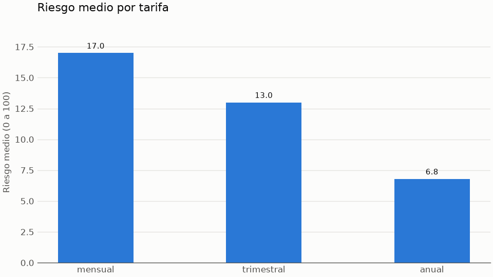
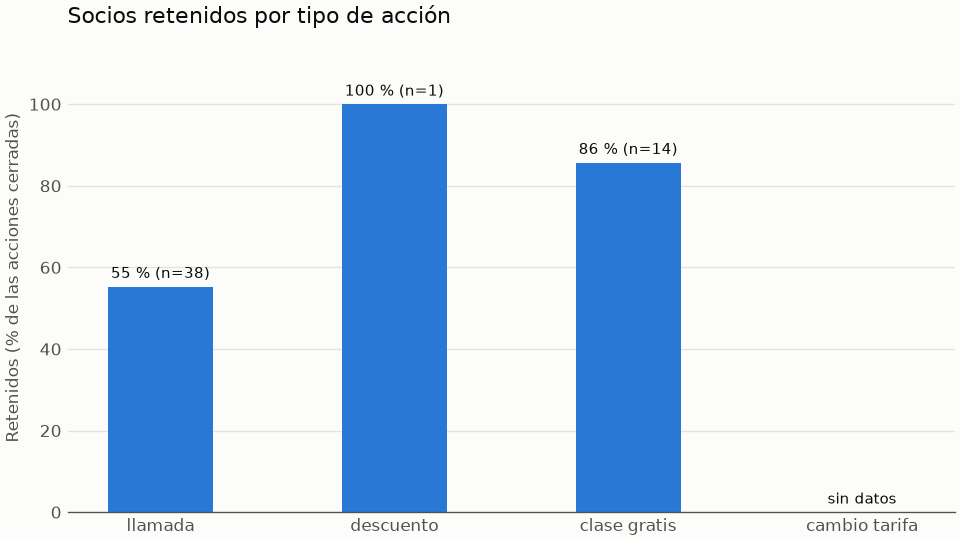

# Radar de Bajas

Sistema de alerta temprana de bajas de socios para un gimnasio. Calcula cada día un índice de riesgo de 0 a 100 por socio, explica por qué, propone una acción para retenerlo y comprueba con el histórico cuánto acierta.

## El problema

Un gimnasio pierde cada mes entre un 2 % y un 5 % de sus socios y casi siempre se entera tarde: cuando llega la baja, el socio llevaba semanas sin venir. Las señales estaban en los datos que ya tiene:

- va menos que antes o ha dejado de venir;
- es nuevo y todavía no ha cogido el hábito;
- tiene una tarifa sin permanencia;
- le acaban de subir la cuota.

Nadie mira esas señales a tiempo porque están repartidas entre el torno de la entrada y la facturación.

## La solución

Radar de Bajas junta esas señales en un índice explicable y las convierte en trabajo concreto para el equipo:

1. **Datos.** Carga socios, visitas y acciones desde CSV, o los genera con un simulador realista y reproducible (300 socios y 12 meses con semilla fija).
2. **Riesgo.** Cada señal suma puntos según su peso y el total se lleva a una escala de 0 a 100.
3. **Explicación.** Cada riesgo viene con sus motivos, por ejemplo: `Riesgo 70: 38 días sin venir; asistencia -100 %; tarifa mensual`.
4. **Validación.** Se calcula el riesgo en fechas pasadas, con lo que se sabía entonces, y se compara con quién se dio de baja después. Se obtienen la precisión, el recall y la matriz de confusión.
5. **Retención.** Para cada socio en riesgo se propone una acción según su causa principal. Cada acción sigue el flujo `propuesta → contactado → retenido / perdido` y se mide qué tipo de acción retiene más.
6. **Informe para la dirección.** Incluye la tasa de abandono mensual, los socios en riesgo, los ingresos en juego y tres gráficos PNG.

No es un gestor de altas y bajas: es una herramienta de análisis y predicción sobre los datos que el gimnasio ya tiene.

## Cómo ejecutarlo

Desde la raíz del repositorio, con el entorno virtual activado (`pip install -r requirements.txt`: pandas, numpy, matplotlib y pytest):

```bash
cd modulo_08_proyecto/radar_bajas
python radar_app.py                 # usa la carpeta datos/
python radar_app.py otra_carpeta    # o la carpeta que se indique
```

La carpeta `datos/` trae un ejemplo generado con la semilla 42, así que la aplicación arranca con datos.

| Opción | Qué hace |
| --- | --- |
| 1 | Genera datos simulados con la semilla elegida (por defecto, 42) y su histórico de acciones |
| 2 | Vuelve a cargar los datos guardados |
| 3 | Muestra los N socios con más riesgo y sus motivos (`!` marca a los que superan el umbral) |
| 4 | Explica el riesgo de un socio señal a señal y recomienda una acción |
| 5 | Valida el modelo con el histórico |
| 6 | Propone una acción a cada socio en riesgo que no tenga una abierta |
| 7 | Avanza el estado de una acción |
| 8 | Muestra las acciones abiertas |
| 9 | Muestra el informe para la dirección |
| 10 | Exporta los gráficos a `datos/graficos/` |
| 0 | Guarda y sale |

Las operaciones se registran en `radar.log`.

Tests:

```bash
pytest modulo_08_proyecto/radar_bajas -v
```

## Arquitectura

Igual que el gestor de incidencias del módulo, la aplicación se organiza en capas. Cada capa solo conoce las que tiene debajo, y solo el menú habla con el usuario.

```
radar_bajas/
├── radar_app.py        Menú de consola: el único sitio con input, print y captura de errores
├── conftest.py         Añade esta carpeta a sys.path para los tests
├── datos/              CSV de ejemplo (semilla 42) y gráficos exportados
├── radar/
│   ├── excepciones.py  ErrorRadar y sus hijas
│   ├── modelos.py      Socio, Visita, AccionRetencion y Gimnasio
│   ├── senales.py      Senal (abstracta) y una subclase por señal
│   ├── radar.py        Radar y Evaluacion: riesgo y explicación
│   ├── validacion.py   Backtesting: matriz de confusión, métricas y barrido de umbrales
│   ├── retencion.py    Recomendación de acciones y GestorRetencion
│   ├── simulador.py    Datos realistas reproducibles con NumPy
│   ├── almacen.py      Guardar y cargar CSV
│   ├── analisis.py     Indicadores con pandas
│   ├── graficos.py     Figuras de matplotlib y exportación a PNG
│   └── informes.py     Textos para mostrar
└── tests/              Un fichero de tests por capa
```

| Capa | Responsabilidad | Qué no hace |
| --- | --- | --- |
| `modelos` | Los datos y sus reglas: un objeto nunca existe en un estado incorrecto | No sabe que existen ficheros ni pantalla |
| `senales` y `radar` | Medir cada señal y combinarlas en el riesgo | No conoce las acciones ni los ficheros |
| `validacion` | Medir cuánto acierta el radar con el pasado | No cambia el radar |
| `retencion` | Proponer acciones y llevar su estado | Las transiciones las valida la propia acción |
| `simulador` | Generar datos de prueba creíbles | No guarda nada |
| `almacen` | Convertir entre objetos y CSV | No decide cuándo se guarda |
| `analisis` y `graficos` | Tablas, indicadores y figuras | No modifican los datos; no imprimen |
| `informes` | Construir textos | No imprime |
| `radar_app` | Pedir datos, mostrar resultados y capturar errores | No tiene reglas de negocio |

## Cómo se calcula el riesgo

Cada señal devuelve una **intensidad** entre 0 y 1 y un texto. Los puntos de la señal son su peso multiplicado por la intensidad. El riesgo es la suma de los puntos dividida entre la suma de los pesos, en una escala de 0 a 100.

| Señal | Peso | Intensidad 0 | Intensidad 1 | Por qué |
| --- | ---: | --- | --- | --- |
| Días sin venir | 35 | 7 días o menos | 30 días o más | Es la señal más directa: quien se va deja de venir antes |
| Caída de asistencia | 25 | Caída de hasta el 20 % | Caída del 90 % o más | Compara el último mes con su propia media de los dos meses anteriores |
| Subida de cuota | 15 | Sin subida en 90 días | Subida del 20 % o más | Una subida reciente invita a replantearse la cuota |
| Antigüedad | 15 | 180 días o más | 30 días o menos | Los socios nuevos aún no tienen el hábito |
| Tarifa | 10 | Anual: 0,1 | Mensual: 1 | Sin permanencia es más fácil irse; trimestral: 0,5 |

Entre los dos extremos la intensidad crece en línea recta. Los pesos y los umbrales son constantes en mayúsculas al principio de `senales.py` y `radar.py`.

Un socio está **en riesgo** si su índice llega a 40 (`UMBRAL_RIESGO`). El umbral sale de la validación: es el punto en el que más o menos una de cada tres alertas acaba en baja sin dejar escapar a la mayoría.

## Validación con el histórico

Se toman 6 fechas de corte, el día 1 de cada uno de los últimos meses. En cada fecha se calcula el riesgo de los socios activos usando **solo las visitas hasta ese día**, y la subida de cuota solo cuenta si ya había ocurrido. Una alerta acierta si el socio se da de baja en los 30 días siguientes. Así salen 1.282 casos (socio y fecha de corte).

Resultados con los datos de ejemplo (semilla 42, umbral 40):

|  | Sin alerta | Alerta |
| --- | ---: | ---: |
| **Se queda** | 1.193 | 45 |
| **Se va** | 24 | 20 |

- **Precisión: 30,8 %.** Casi una de cada tres alertas acaba en baja.
- **Recall: 45,5 %.** Casi la mitad de las bajas tuvieron alerta con hasta un mes de antelación.
- **Tasa base: 3,4 %.** Es la precisión de avisar al azar; la alerta es **9 veces más precisa**.

El barrido de umbrales muestra el equilibrio entre precisión y recall:

| Umbral | Alertas | Aciertos | Precisión | Recall |
| ---: | ---: | ---: | ---: | ---: |
| 20 | 307 | 39 | 12,7 % | 88,6 % |
| 30 | 115 | 29 | 25,2 % | 65,9 % |
| **40** | **65** | **20** | **30,8 %** | **45,5 %** |
| 50 | 41 | 19 | 46,3 % | 43,2 % |
| 60 | 22 | 10 | 45,5 % | 22,7 % |
| 70 | 10 | 6 | 60,0 % | 13,6 % |

Si la acción es barata, como una llamada, compensa bajar el umbral a 30 y avisar de dos de cada tres bajas a cambio de más falsas alarmas. Si es cara, como un descuento, conviene subirlo a 50.

Las bajas que no se detectan son sobre todo las de socios que se van sin avisar con su asistencia: siguen viniendo con normalidad hasta poco antes de irse. Las falsas alarmas vienen sobre todo de socios que hacen una pausa (vacaciones, una lesión) y vuelven.

## Acciones de retención

La acción se elige según la señal que más puntos suma:

| Causa principal | Acción |
| --- | --- |
| Días sin venir | Llamada |
| Caída de asistencia | Clase gratis |
| Antigüedad baja | Clase gratis |
| Subida de cuota | Descuento |
| Tarifa | Cambio de tarifa |

Cada acción solo puede seguir el flujo `propuesta → contactado → retenido / perdido`, o pasar directamente de `propuesta` a `perdido`. Los cambios los valida la propia acción con la tabla `TRANSICIONES_ACCION`, y al cerrarse se anota la fecha. Un socio no puede tener dos acciones abiertas a la vez.

El informe compara la tasa de retención de cada tipo de acción. Solo nombra una "acción que más retiene" si tiene al menos 5 acciones cerradas: un 100 % sobre una sola acción no dice nada.

## Informe para la dirección

Con los datos de ejemplo, a 31/10/2026:

- 209 socios activos.
- 6 socios en riesgo (2,9 %), con 265 € al mes en juego (3.180 € al año).
- Tasa de abandono mensual media del 3,6 %.







## Datos simulados

`simulador.py` genera los datos con un `numpy.random.Generator` y una semilla fija, así que la misma semilla da siempre los mismos datos. Reglas principales:

- El 70 % de los socios ya estaba antes del periodo; el resto se da de alta durante el año.
- La tarifa es mensual en el 50 % de los casos, trimestral en el 30 % y anual en el 20 %. El 30 % de los socios sufre una subida de cuota de entre el 8 % y el 25 %.
- La probabilidad mensual de baja depende de la tarifa (del 1 % al 3,5 %) y aumenta durante los primeros 90 días y durante los 90 días siguientes a una subida.
- Cada socio tiene su propio ritmo de visitas (unas 8 al mes de media). Quien se va reduce su asistencia durante los 60 días anteriores a la baja y deja de venir del todo entre 7 y 25 días antes.
- El 15 % de los socios que se quedan hace una pausa de 10 a 25 días: son las falsas alarmas.
- También se simulan las bajas de los dos meses siguientes al final de los datos. No se guardan, porque todavía no han ocurrido, pero su declive ya aparece en las visitas. Sin esto, el último día nadie estaría "apagándose" y el radar no tendría nada que detectar.
- El histórico de acciones se genera proponiendo cada mes una acción a los socios en riesgo. El resultado sale de los propios datos: perdido si el socio se dio de baja en los 60 días siguientes y retenido si no.

## Decisiones de diseño

- **Un índice de puntos explicable, no un modelo de caja negra.** El gerente tiene que poder entender por qué un socio está en riesgo y qué hacer. Cada punto del índice tiene un motivo escrito, y la validación demuestra que funciona.
- **Polimorfismo en las señales.** `Senal` es abstracta, y `Radar` las recorre sin saber cuál es cada una. Añadir una señal nueva es escribir una subclase con `medir` y darle un peso en `PESOS`.
- **Composición.** `Radar` tiene una lista de señales, `Gimnasio` tiene socios y visitas y `GestorRetencion` tiene acciones. El gestor delega los cambios de estado en `AccionRetencion.avanzar`.
- **Estado siempre válido.** Las dataclasses validan en `__post_init__`. `Visita` es inmutable (`frozen=True`). `desde_fila` es un `@classmethod` que actúa como constructor alternativo desde el CSV y es el inverso de `a_fila`.
- **Sin fugas del futuro.** `Radar.evaluar` solo recibe las visitas hasta la fecha evaluada (`Gimnasio.visitas_hasta`, con búsqueda binaria), y la subida de cuota solo cuenta si ya había ocurrido. Sin esto, la validación daría resultados mejores que la realidad.
- **La fecha de referencia sale de los datos.** "Hoy" es el último día con datos (`Gimnasio.fecha_referencia`), no la fecha del ordenador. Por eso los resultados son reproducibles y los tests no dependen del día en que se ejecutan.
- **Validación con varios cortes.** Con un solo corte había apenas una decena de bajas y las métricas bailaban mucho. Seis cortes mensuales dan unos 1.300 casos.
- **Errores.** `ErrorRadar` es la base de todas las excepciones propias. Los `try` son cortos y encadenan la causa con `raise ... from`, y solo el menú captura, con un único `except ErrorRadar`. Un fichero corrupto detiene la carga indicando el fichero y la línea, porque no se puede trabajar con la mitad de los datos.
- **Menú con un diccionario de funciones.** Cada opción es una función pequeña que recibe la `Sesion`. Entradas incorrectas, Ctrl+D y Ctrl+C nunca terminan con una traza.
- **pandas sin bucles sobre filas.** Se usan `groupby` con `agg`, `pd.Grouper` y `resample` por mes, `crosstab` para la matriz de confusión y la eficacia, máscaras booleanas y difusión de NumPy para contar los activos de cada mes. Incluso las tablas de texto de los informes se componen con operaciones de columna (`.str.rjust`).

## Tests

167 tests repartidos por capa, con fixtures (un gimnasio simulado con semilla fija que comparte toda la sesión) y `parametrize`. Cubren:

- las reglas de los modelos y las transiciones;
- cada señal por separado, el riesgo y la explicación;
- la validación y la retención;
- el simulador y el almacén (ida y vuelta CSV con `tmp_path`, columnas que faltan, fila no válida con su línea);
- el análisis, los gráficos y los informes;
- el menú completo con `monkeypatch` de `input`.

## Limitaciones y mejoras

- **Pesos fijados a mano.** Con datos reales se podrían ajustar con una regresión logística (scikit-learn) y comparar su precisión con la de este índice usando la misma validación.
- **La eficacia de las acciones no prueba que funcionen.** En los datos simulados el resultado de cada acción sale de si el socio se fue, así que no mide su efecto real. Para medirlo habría que dejar un grupo de control sin acción.
- **Datos de ejemplo.** Con datos reales, la fecha de referencia sería la de hoy y las visitas llegarían del torno de acceso.
